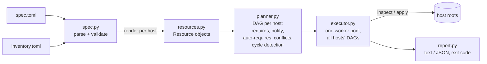

# idemrun

A small declarative configuration-automation engine, in the spirit of Ansible or
Puppet but much smaller. You describe the desired state of a set of hosts in a
TOML spec (directories, files rendered from templates, single lines in config
files, symlinks, paths that must not exist, guarded shell commands, handlers),
and idemrun works out what has to change on each host and applies only that.

Running it again on a converged host changes nothing. `check` mode is a
read-only dry run, so it also works as a drift detector: it lists every
resource whose real state no longer matches the spec.

Each "host" is a root directory on the local machine (for example
`fleet/web1/`), and all resource paths are resolved inside that root. This
means a whole fleet can be provisioned and tested on one machine without root
access. There is no SSH transport (see Limitations).

Python 3.11+, standard library only (`tomllib`, `concurrent.futures`). `pytest`
is needed for the tests.

## Quick start

```sh
python -m pip install -e ".[test]"
cd examples/webfleet

idemrun plan  site.toml -i inventory.toml          # execution order per host
idemrun check site.toml -i inventory.toml --diff   # dry run: what would change
idemrun apply site.toml -i inventory.toml          # converge all hosts
idemrun apply site.toml -i inventory.toml          # second run: 0 changes
```

Exit codes: `0` success / no drift, `1` drift found by `check`, `2` a resource
failed, `3` invalid spec or plan. Other options: `--limit 'web*'`, `--jobs N`,
`--json`, `--verbose`, and `--root DIR` (one host, no inventory).

### Spec example

```toml
[vars]
app = "shop"

[[resource]]
type = "directory"
path = "etc/{{app}}"
mode = "0755"

[[resource]]
type = "file"
name = "app-config"
path = "etc/{{app}}/app.conf"
source = "templates/app.conf"      # rendered with host variables
mode = "0640"
notify = "reload-app"

[[resource]]
type = "line"                       # edit one setting in a file we don't own
path = "etc/sysctl.conf"
line = "net.core.somaxconn = 4096"
match = "^net\\.core\\.somaxconn"
create = true

[[resource]]
type = "command"
name = "init-db"
hosts = "db*"                       # only hosts matching this glob
cmd = "mkdir -p var/lib/{{app}} && echo schema-1 > var/lib/{{app}}/schema"
creates = "var/lib/{{app}}/schema"  # guard: makes it idempotent

[[resource]]
type = "command"
name = "reload-app"
handler = true                      # runs only if something notified it and changed
cmd = "echo reload >> var/log/{{app}}/reloads.log"
```

The full example is in [`examples/webfleet/`](examples/webfleet). Variables
come from the spec's `[vars]`, then the inventory's `[vars]`, then per-host
keys, then the built-in `host`; later ones win. An undefined `{{ var }}` is an
error, not an empty string.

| type | parameters | idempotent because |
|---|---|---|
| `file` | `path`, `content` or `source`, `mode` | compares SHA-256 of content and the mode; writes atomically (temp file + rename) |
| `directory` | `path`, `mode` | exists + mode check |
| `line` | `path`, `line`, `match` (regex), `state`, `create` | no-op if the line is already present; with `match`, replaces the last matching line |
| `symlink` | `path`, `target` | compares `readlink`; replaces atomically |
| `absent` | `path` | no-op if the path does not exist |
| `command` | `cmd`, `creates`, `unless`, `timeout` | skipped if `creates` exists or `unless` exits 0 |

Every resource also accepts `name`, `requires`, `notify`, `handler` and `hosts`.

## Architecture



- **`resources.py`**: each resource type has `inspect(ctx) -> [changes]` and
  `apply(ctx, changes)`. An empty change list means "already converged". In
  check mode `apply` is never called.
- **`spec.py`**: loads the TOML spec and inventory, validates parameters, and
  renders `{{ var }}` templates once per host into concrete resources.
- **`planner.py`**: builds the dependency graph for one host. Edges come from
  `requires`, from `notify` (a handler runs after everything that can notify
  it), and from auto-requires (anything under a managed directory depends on
  that directory). Several `line` edits to the same file are chained in
  declaration order, because they are read-modify-write and would lose
  updates if they ran concurrently. Those are ordering-only edges: if one edit
  fails, the next one still runs. The planner rejects specs that can never
  converge: unknown or ambiguous references, two resources owning the same
  path, a `line` edit inside a file whose whole content a `file` resource owns
  (they would undo each other on every run), notifying a non-handler, and
  cycles. Cycles are reported with the actual path, e.g.
  `command[a] -> command[b] -> command[a]`. Execution order is a topological
  sort with ties broken by declaration order, so `plan` output is stable.
- **`executor.py`**: treats every (host, resource) pair as a node in one
  combined DAG and runs it on a single `ThreadPoolExecutor`. A node is submitted
  as soon as all its dependencies have finished, so one slow host does not hold
  back the others. When a resource fails, everything that `requires` it,
  directly or transitively, is marked `skipped` without running. Independent
  resources and other hosts carry on. A handler runs at most once per host,
  and only if at least one notifier reported a change. In check mode, if a
  dependency is itself pending (for example the file a `line` edits has not
  been created yet), the resource is reported as `would_change` with "unknown
  until dependencies are applied" instead of as a false failure.

Statuses: `ok`, `changed`, `would_change` (check mode), `failed`, `skipped`,
`not_notified`.

## Tests

```sh
python -m pytest -v
```

There are 52 tests. They cover:

- every resource type, including mode-only changes, atomic writes and path
  escape (`../`) rejection;
- template rendering and variable precedence;
- every planner rejection case;
- failure propagation that stays inside one host;
- handler semantics;
- check mode writing nothing;
- dependency order under real concurrency, checked from recorded start and end
  timestamps;
- the `--jobs` concurrency bound;
- an end-to-end CLI run of the example fleet, including tampering with a host
  and repairing it.

The benchmark below found a real bug: concurrent `line` edits to a shared file
lost updates. A regression test now covers it (`test_line_edits_to_one_file_are_serialised`).

## Benchmark

```sh
python bench/bench.py            # full run (numbers below)
python bench/bench.py --quick    # small version, run in CI
```

The benchmark generates a fleet and measures three things:

1. **Converge.** A cold `apply`, then a second `apply` (which must change
   nothing), then a `check`.
2. **Drift detection.** It randomly tampers with managed objects across the
   fleet and checks that `check` flags exactly those. The tampering edits file
   content, `chmod`s, deletes files, retargets symlinks and removes managed
   lines. It then repairs them with `apply`.
3. **Scheduling.** Command resources that each `sleep 0.05` (standing in for
   slow operations like package installs) are arranged in 3 dependent layers
   of 4 per host and run with different `--jobs` values.

The script exits non-zero if the second apply changes anything, or if drift
precision or recall is below 1.0.

Measured on this machine (Python 3.12.14, macOS arm64, 28 CPUs); raw output is
in [`bench/results-full.json`](bench/results-full.json):

**Converge**, 50 hosts × 81 resources = 4050 resources, `--jobs 8`
(10 directories, 40 templated files, 20 line edits spread over 4 shared files,
10 symlinks per host):

| run | wall (s) | resources/s | changed |
|---|---|---|---|
| plan (render + DAG) | 0.022 | - | - |
| first apply | 0.510 | 7948 | 4050 |
| second apply | 0.300 | 13501 | 0 |
| check | 0.291 | 13905 | 0 drifted |

**Drift detection**, 100 random tamperings across the 50 hosts: `check`
flagged 100, all 100 correct (precision 1.000, recall 1.000) in 0.298 s. The
following `apply` repaired all 100, and a final `check` showed 0 drift.

**Scheduling**, 8 hosts × 12 commands (96 total, `sleep 0.05` each). The
per-host critical path is 0.15 s:

| jobs | wall (s) | speedup vs jobs=1 |
|---|---|---|
| 1 | 6.463 | 1.0x |
| 4 | 1.577 | 4.1x |
| 16 | 0.433 | 14.9x |
| 64 | 0.299 | 21.6x |

How to read these numbers:

- **Speedup at `--jobs 4` and `--jobs 16`.** It is a little above the worker
  count. Each command costs about 67 ms at `--jobs 1` (6.463 s / 96), which is
  the 50 ms sleep plus spawning a shell. When workers overlap, the spawn cost is
  partly hidden.
- **Speedup at `--jobs 64`.** At most 32 commands can be ready at once (8 hosts
  × 4 per layer), so it levels off well below 64.
- **Where converge time goes.** These are small local files, so converge
  throughput mostly measures Python and filesystem overhead.

## Limitations

- **Local only.** Hosts are directories on the local machine. There is no
  SSH/WinRM transport, no privilege escalation and no ownership (`chown`)
  management. Adding a transport would mean running `inspect`/`apply` remotely.
- **No package or service resource types.** Use `command` with
  `creates`/`unless` guards instead.
- **Simple templates.** Only `{{ name }}` substitution: no loops, conditionals
  or filters.
- **Threads, not processes.** This suits I/O and subprocess work. CPU-heavy
  custom resources would be limited by the GIL.
- **Possible spurious cycle.** The ordering of `line` edits to one file follows
  declaration order. If you also make an earlier edit `require` a later one, the
  planner reports a cycle.
- **`unless` runs in check mode.** `check` runs `unless` guard commands, just as
  Ansible's check mode runs its probes. Those commands should be read-only.
- **Single-run state.** Handlers fire within one run. If a run is interrupted
  after a change but before its handler, the next run will not know the handler
  is still owed.
